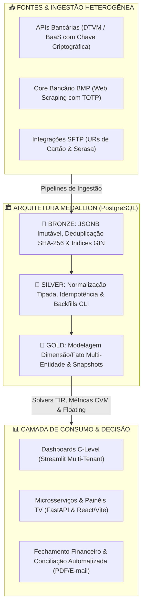

# Olá, sou o Lucas Visciano Rodrigues 👋

### **Senior Analytics Engineer | Financial Data Platform Engineer**
📍 São Paulo, SP / Brasil (Disponível para oportunidades Remotas ou Híbridas)  
💼 Conectando regras de negócio financeiras complexas a arquiteturas de dados escaláveis, resilientes e de alta performance.

---

## 🎯 Sobre Mim & Visão de Engenharia

Engenheiro de Dados e Analytics Engineer com mais de 7 anos de experiência no ecossistema analítico e financeiro. Com histórico comprovado de alta cadência de entregas em produção em esteiras de CI/CD, atuo na sustentação e evolução contínua de plataformas de dados — cobrindo desde a arquitetura de dados (PostgreSQL, arquitetura Medallion, modelagem dimensional) até a extensão de microsserviços e APIs transacionais.

- 🏗️ **Arquitetura de Plataforma de Dados:** Construção de ecossistemas completos em arquitetura Medallion (*Bronze JSONB imutável com deduplicação por hash SHA-256 e índice GIN; Silver normalizada e idempotente; Gold dimensional com fatos/dimensões multi-entidade e snapshots auditáveis append-only*).
- 💰 **Engenharia Financeira & Finanças Estruturadas:** Domínio em regras de crédito (FIDCs, Risco Sacado, BaaS, conciliação de core bancário e compliance CVM). Desenvolvimento de solvers numéricos de alta complexidade diretamente na camada de dados (Taxa Interna de Retorno - TIR via método de Newton-Halley e modelagem de floating).
- ⚙️ **Software Engineering for Data:** Desenvolvimento de microsserviços e pipelines resilientes com Python (FastAPI), TypeScript (NestJS/Prisma com queries SQL brutas otimizadas e CTEs paralelas), conteinerização com Docker e CI/CD automatizado via GitHub Actions.
- 🤝 **Interlocução C-Level:** Histórico de fechamentos financeiros e auditoria bancária executiva centavo a centavo diretamente com a diretoria.

---

## 🛠️ Tecnologias & Ecossistema

### **Engenharia & Modelagem de Dados**

- **Padrões de Dados:** Arquitetura Medallion (Bronze/Silver/Gold), Modelagem Dimensional (Star Schema, Snowflake), Upserts Idempotentes por Chave Natural, CDC, Hashing Criptográfico (SHA-256), Backfills Automatizados via CLI (`argparse`).

### **Engenharia de Software & Backend**

- **Boilerplates & Padrões:** Arquitetura Modular (Repository Pattern, Use Cases, DTOs, Factories), Contratos de API (OpenAPI), Autenticação Stateless (HMAC), Integração com APIs Bancárias assinadas criptograficamente.

### **DataOps, Cloud & Visualização**

- **Infra & Monitoramento:** Docker Compose, Azure App Service, Azure Key Vault, Linux Cron, APScheduler, Relatórios Automatizados em PDF (ReportLab) e Excel (OpenPyXL).

---

## 🚀 Arquiteturas & Destaques de Produção

### Principais Frentes Técnicas Desenvolvidas:
1. **Plataforma de Dados Medallion & Fechamento Financeiro:** Ingestão de APIs de custódia e core bancário com deduplicação por hash, conciliação diária de receitas (tarifas e floating) e geração automática de relatórios executivos para diretoria.
2. **Framework de Dados Modular:** Template de microsserviço corporativo em FastAPI, SQLAlchemy e Alembic, preparado para testes in-memory com SQLite e orquestração de crons via APScheduler.
3. **APIs Transacionais & Geração CNAB 444:** Desenvolvimento de endpoints externos de alta performance em NestJS/Prisma com queries SQL raw em paralelo e motor de geração de arquivos posicionais bancários CNAB 444.
4. **Motor de Simulação & Regras de Negócio (Solo RPG Engine):** Projeto autoral explorando Orientação a Objetos avançada, Design Patterns (State, Factory), controle determinístico de eventos e suíte completa de testes unitários.

---

## 📈 Formação Acadêmica & Certificações

- **Bacharelado em Ciência de Dados** – UNIVESP *(Cursando)*
- **MBA em Gestão Estratégica de Pessoas** – UNOPAR
- **Engenharia de Dados & Cloud Data Lakes** – Alura (Processamento Distribuído, Docker, Bancos Relacionais)
- **Data Science com Python & Análise Quantitativa** – Santander / DIO
- **Inglês:** Avançado (Leitura técnica fluente, comunicação corporativa)

---

## 📫 Vamos Conversar?

Estou ativamente aberto a conexões e novas oportunidades em **Analytics Engineering**, **Engenharia de Dados** e **Arquitetura de Dados em Fintechs**:

- **LinkedIn:** [linkedin.com/in/lucasvisciano](https://linkedin.com/in/lucasvisciano)
- **E-mail:** [lucas.visciano@gmail.com](mailto:lucas.visciano@gmail.com)
- **Localização:** São Paulo, SP (Disponível para atuar Remoto ou Híbrido)
